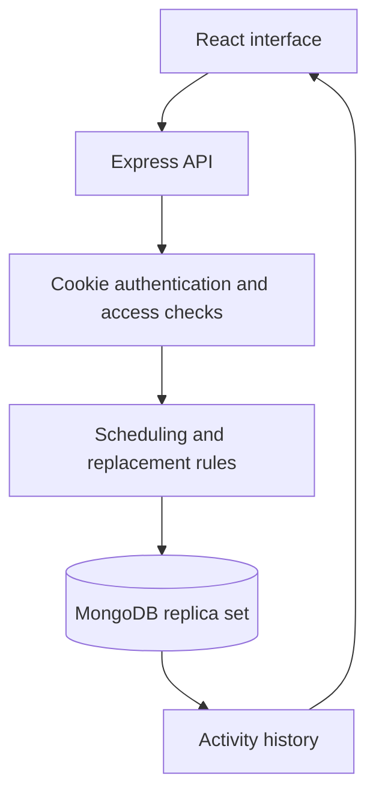

# CrewSync
**Every volunteer. Every shift. In sync.**

CrewSync is a MERN application for coordinating campus event volunteers. Organisers publish events and shifts; volunteers join duties, request replacements, and help teammates. Organisers track coverage and attendance.

**Author:** Ekamjeet Singh
**Project type:** Solo end-term software project
**Delivery status:** Source and production build prepared. See [verification status](docs/VERIFICATION.md) for checks and outstanding publishing steps. No public deployment or GitHub URL is claimed until verified.

## Problem and target users
Campus events are often coordinated through group chats and spreadsheets. Organisers cannot easily tell which duties are understaffed, whether a volunteer has overlapping shifts, or who is responsible after a cancellation.

- **Organisers:** student clubs, event leads, campus coordinators.
- **Volunteers:** students offering time and covering teammates' duties.

## The four complete product workflows
1. **Plan:** register as an organiser, create an event, add duties with start/end times and volunteer capacity.
2. **Join:** volunteers browse events and join shifts. The API rejects full shifts, duplicate assignments, shifts already started, and overlapping commitments.
3. **Replace:** a volunteer requests cover but remains assigned. Another eligible volunteer accepts; the transfer happens in one database transaction.
4. **Attend:** the event owner marks attendance after a shift starts and sees understaffed duties and activity history.

Additional supporting functionality: account registration/login/logout, search, upcoming/past filters, cancellation of events, responsive layouts, loading/error/empty states, persistent records, and 30-second dashboard refresh.

## Stack
| Layer | Technology | Reason |
|---|---|---|
| Browser | React + Vite | Component-based interface and small static build |
| API | Node.js + Express | Straightforward HTTP endpoints and middleware |
| Database | MongoDB + Mongoose | Document models, indexes, multi-document transactions |
| Authentication | bcrypt + JWT in HTTP-only cookie | Password hashing and server-verified identity |
| Tests | Node test runner + MongoDB Memory Server replica set | Exercise real HTTP workflows and concurrency |
| Deployment | Vercel configuration; also supports a single Node service | Same-origin API and frontend avoid cross-site cookie setup |

No paid APIs, AI model, payment provider, or external email service is needed.

### Demo accounts
For the local demo, all accounts below use **CrewSyncDemo2026!**.

| Role | Email |
|---|---|
| Organiser | organiser@crewsync.demo |
| Volunteer | volunteer@crewsync.demo |
| Replacement volunteer | cover@crewsync.demo |

These are intentionally public **synthetic demonstration accounts**, not personal credentials. Create your own account for separate ownership. Do not store private information in shared demo accounts.

Demo events are dated relative to the first seed. The orientation shift starts immediately so attendance can be demonstrated. Seeding is non-destructive and does not reset existing events.

## Environment variables
| Variable | Purpose |
|---|---|
| MONGO_URI | Server-only MongoDB connection string |
| MONGO_DB | Separate database name; defaults to crewsync |
| JWT_SECRET | Random signing secret of at least 32 characters |
| PORT | Local/API service port; defaults to 3100 |
| NODE_ENV | Set production on HTTPS deployments for secure cookies |
| SEED_PASSWORD | Password used only when seeding synthetic accounts; at least 10 characters |

The `.env` file is ignored. Never paste credentials into the README, frontend source, or GitHub. The development machine has a CrewSync-only environment file; it does not change ShopKart's configuration.

## Architecture


See [architecture decisions](docs/ARCHITECTURE.md) and [API reference](docs/API.md).

## Project structure
- `src/main.jsx`: workspace state and feature views.
- `src/components/`: authentication, dialogs, forms, and shared UI.
- `src/api.js`: same-origin API requests and error messages.
- `src/utils.js`: display date/time helpers.
- `src/styles.css`: responsive design and accessible interaction states.
- `server/app.js`: API routes, authentication, resource authorization.
- `server/service.js`: validation and transactional assignment changes.
- `server/models.js`: data schemas and indexes.
- `server/security.js`: security headers and persistent sign-in rate limit.
- `server/demo-data.js`: non-destructive synthetic data.
- `api/index.js`: Vercel function entry.
- `tests/`: validation and integration tests.
- `docs/`: deployment, demo, architecture, submission, verification.

## Validation
```powershell
npm run check
npm run test:unit
npm run test:integration
npm run build
```

Integration tests use an isolated MongoDB replica set, not your production database. They exercise two users competing for the final place, one user booking overlapping shifts concurrently, replacement races, owner-only attendance, persistence, and cancellation.

**Do not confuse a successful build with a verified database workflow.** The development sandbox prevented database integration tests from running; the exact limitations are recorded in [VERIFICATION.md](docs/VERIFICATION.md).

## Deployment and submission
- [Deployment guide](docs/DEPLOYMENT.md)
- [3–5 minute demo script](docs/DEMO.md)
- [Submission form content and checklist](docs/SUBMISSION.md)
- [Viva preparation](docs/VIVA.md)

## Scope and limitations
- Events are visible to all signed-in volunteers; there is no college email verification.
- An organiser can manage only events they own. Choosing organiser at registration does not confer authority over other organisers.
- Dates are stored in UTC and displayed using the viewer's local timezone.
- Requests for cover do not remove responsibility until accepted.
- Updates are polled every 30 seconds; this is not a WebSocket app.
- No email/SMS notifications, skills matching, payments, event editing, or waitlists are advertised.
- JWT logout removes the browser cookie; server-side token revocation and password recovery are outside this scope.
- MongoDB transactions require replica-set or sharded deployment.
- Public demo accounts share synthetic state and can affect one another's demonstration.

## Originality and attribution
CrewSync was designed for this project around event staffing, scheduling conflicts, and accountable replacement workflows. Standard open-source dependencies are listed in package.json. AI assistance was used to implement and document the project; the author should review the code and be able to explain its engineering decisions. ShopKart source files were not modified or used as the application implementation.
